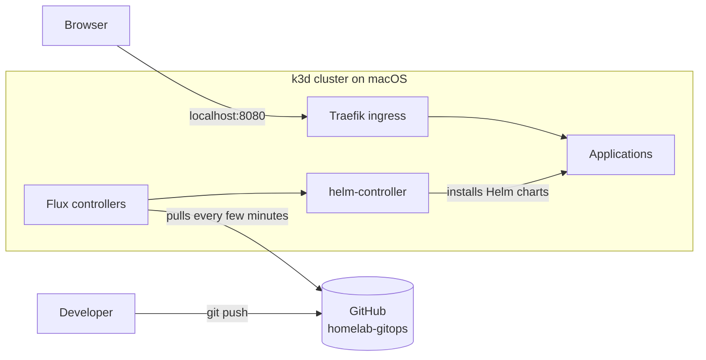

# homelab-gitops

A local Kubernetes homelab managed entirely through GitOps. Everything running in the cluster is declared in this repository, and [Flux](https://fluxcd.io) keeps the cluster in sync with it. Nothing is applied by hand: changes go in as commits.

## Architecture



- **Cluster:** [k3d](https://k3d.io) (k3s in Docker) with 1 server and 2 agents, running on [Colima](https://github.com/abiosoft/colima)
- **GitOps:** Flux v2 with Kustomizations and HelmReleases
- **Ingress:** Traefik, which ships with k3s, exposed on `localhost:8080`

## Repository layout

```
.
├── clusters/homelab/
│   ├── flux-system/        # Flux components, generated by `flux bootstrap`
│   └── apps.yaml           # Tells Flux to reconcile ./apps
├── apps/
│   ├── kustomization.yaml  # List of applications
│   └── podinfo/            # Namespace, HelmRepository and HelmRelease
├── k3d.yaml                # Cluster definition (k3s version, nodes, ports)
└── Makefile                # Shortcuts for common tasks
```

## Getting started

### Prerequisites

macOS with [Homebrew](https://brew.sh):

```bash
brew install colima docker kubectl k3d helm k9s
brew install fluxcd/tap/flux
```

### Create the cluster

```bash
make up
```

This starts Colima and creates the cluster from `k3d.yaml`. If the cluster already exists, it is started instead.

### Install Flux

Flux needs a GitHub personal access token with the `repo` scope, used only during bootstrap:

```bash
read -s GITHUB_TOKEN && export GITHUB_TOKEN
make bootstrap
```

To run this from your own fork, override the owner: `make bootstrap GITHUB_OWNER=<your-username>`.

After a minute or two, all applications are installed. Check with:

```bash
make status
```

Then open http://podinfo.localhost:8080.

### Everyday commands

| Command          | What it does                                                            |
| ---------------- | ----------------------------------------------------------------------- |
| `make up`        | Start Colima and the cluster                                            |
| `make down`      | Stop everything, keeping all state                                      |
| `make status`    | Show nodes, Kustomizations and HelmReleases                             |
| `make reconcile` | Make Flux pull from Git immediately                                     |
| `make destroy`   | Delete the cluster (run `make bootstrap` after `make up` to restore it) |

## How a change is deployed

1. Edit a manifest, for example `replicaCount` in `apps/podinfo/release.yaml`.
2. Commit and push to `main`.
3. Flux detects the new commit and applies it. Run `make reconcile` to skip the wait.

If someone changes the cluster by hand, Flux reverts it to what is declared in Git.

## Roadmap

- [x] Local k3d cluster with Flux bootstrap
- [x] First application deployed with a HelmRelease and exposed through Ingress
- [x] `infrastructure/` layer with Prometheus and Grafana, deployed before apps
- [ ] Own application with its own Helm chart and CI pipeline
- [ ] Flux image automation for automatic deploys of new image tags
- [ ] Secrets management with SOPS
